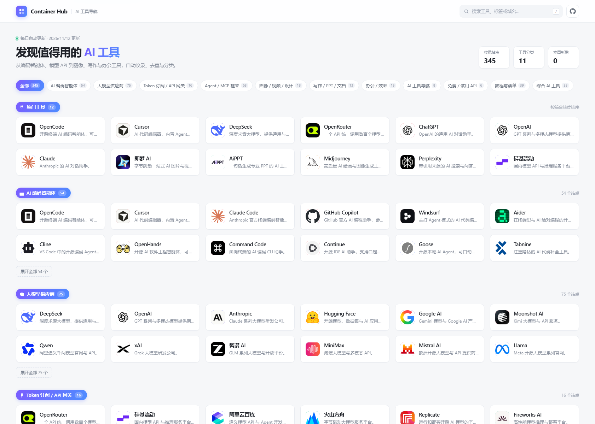

# Container Hub · AI 工具导航

一个部署在 GitHub Pages 上的 AI 网站导航：**每天自动抓取新站 → 去重 → 自动分类 → 更新 `data/data.json`**，页面按附件里的卡片网格展示。

> GitHub 用户：<https://github.com/flairamos>（FlairAmos，已确认存在）  
> 个人主页：<https://flairamos.github.io/>（已在线）  
> 目标仓库：<https://github.com/flairamos/container-hub>（公开访问返回 404，可能尚未创建或为私有）  
> 在线地址（部署后）：<https://flairamos.github.io/container-hub/>

> 本项目默认部署为**独立项目站** `/container-hub/`，不会覆盖你现有的 `flairamos.github.io` 个人主页。



## 特性

- **卡片式布局**：6 列自适应网格，热门工具 12 张卡片，图标 + 名称 + 单行描述，和参考图一致。
- **每日自动更新**：GitHub Actions 每天 03:23 UTC 运行，抓取、分类、提交数据，Pages 自动重新部署。
- **多信息源**：models.dev、Hacker News Show HN、Product Hunt RSS、4 个 awesome 清单，外加 90+ 个人工种子站。
- **三级分类**：品牌规则 → 关键词规则 → DeepSeek 兜底，LLM 结果按 URL 哈希缓存，不重复烧 token。
- **零运行时依赖**：使用 Node 20+ 内置 `fetch` 和轻量 HTML/RSS 解析，不需要 `npm install`。
- **图标本地化**：抓取站点 favicon / apple-touch-icon 存到 `assets/icons/`，失败时用渐变色首字母占位，避免运行时依赖第三方图标服务。
- **健康检查**：每日 ping 站点，403/429 视为在线，连续 7 次失败才标为离线。
- **搜索 / 分类筛选 / 热门排序 / NEW 标记 / 离线标记**，纯静态，无后端。

## 快速开始

要求 Node.js 20 或更高版本。

```bash
# 1. 首次抓取（不 ping，速度快；会补标题、描述和图标）
npm run crawl:fast

# 2. 本地预览
npm run dev
# 打开 http://127.0.0.1:4173
```

完整抓取（包含健康检查）：

```bash
npm run crawl
```

生成结果在 `data/data.json`，图标在 `assets/icons/`。`data/data.preview.json` 是 `--dry-run` 的输出，不会被页面读取。

## 部署到 GitHub Pages

1. 在 `flairamos` 账号下新建一个 **Public** 仓库，名称填 `container-hub`。
2. 本地目录已经初始化并提交过，直接关联远端并推送：

   ```bash
   git remote add origin https://github.com/flairamos/container-hub.git
   git push -u origin main
   ```

3. 仓库 **Settings → Pages → Build and deployment**：
   - Source 选 **Deploy from a branch**
   - Branch 选 **main**，目录选 **/ (root)**
   - 保存后等待 1–2 分钟，访问 `https://flairamos.github.io/container-hub/`。

4. 如果仓库名不是 `container-hub`（例如你直接用 `flairamos.github.io`），修改这两处：
   - `scripts/config.mjs` 里的 `SITE.repo` 和 `SITE.pages`
   - `index.html` 顶栏和页脚的 GitHub 链接
   - `README.md` 顶部的在线地址与推送命令

> 页面全部使用相对路径，放在用户主页仓库（`<user>.github.io`）或项目仓库（`<user>.github.io/<repo>/`）都能正常访问。

## 每日自动抓取

工作流文件：`.github/workflows/crawl.yml`

- 定时：`23 3 * * *`（UTC），对应北京时间 11:23，避开 GitHub 整点高峰。
- 手动：仓库 **Actions → Daily AI Sites Crawl → Run workflow**。
- 首次建议先手动跑一次，确认能 commit 后再等定时任务。

### 可选：启用 LLM 分类

规则没命中的站点才会调用 DeepSeek，最多每次 25 个，结果缓存在 `data/cache/llm-classify.json`。

1. 到 [DeepSeek 开放平台](https://platform.deepseek.com/) 创建 API Key。
2. 仓库 **Settings → Secrets and variables → Actions → New repository secret**，名称填 `DEEPSEEK_API_KEY`。
3. 不配置也能跑：所有未命中规则的站点会归入「综合 AI 工具」。

成本参考：单次分类 < 1 分钱，每日兜底通常 < ¥1。

## 信息源

| 信息源 | 地址 / 接口 | 用途 |
| --- | --- | --- |
| 种子站点 | `scripts/config.mjs` 的 `SEEDS` | 保证开箱有内容，人工校准标题和描述 |
| models.dev | `https://models.dev/api.json` | 模型供应商 / API 网关 |
| Hacker News | `hn.algolia.com/api/v1/search_by_date` | 发现 Show HN 新项目 |
| Product Hunt | `producthunt.com/feed?category=ai` | 当日 AI 新产品（部分网络环境可能 403） |
| awesome 清单 | jsDelivr → ghproxy → GitHub API | 免费 API、Claude Code、MCP Server |

单个源失败只记日志，不会让整个工作流失败。README 抓取结果会缓存 12 小时到 `data/cache/readmes/`，减少 GitHub API 限额压力。

## 分类体系

核心 7 类（与实施手册一致）加 4 个扩展类：

| ID | 名称 | 说明 |
| --- | --- | --- |
| `coding-agent` | AI 编码智能体 | 终端 / IDE 里的 AI 程序员 |
| `llm-provider` | 大模型供应商 | 模型官方与 API 入口 |
| `token-gateway` | Token 订阅 / API 网关 | 统一接入、计费与路由 |
| `agent-framework` | Agent / MCP 框架 | 构建智能体与工具生态 |
| `ai-media` | 图像 / 视频 / 设计 | 图片、视频、设计稿生成 |
| `ai-writing` | 写作 / PPT / 文档 | 文案、演示与文档处理 |
| `ai-productivity` | 办公 / 效率 | 搜索、会议与工作流 |
| `ai-directory` | AI 工具导航 | 发现更多 AI 产品 |
| `free-api` | 免费 / 试用 API | 免费额度与开源模型 |
| `learning` | 教程与清单 | awesome 清单与学习资源 |
| `ai-tool` | 综合 AI 工具 | 通用对话与多场景助手 |

分类实现见 `scripts/classifier.mjs`：

1. **品牌规则**：`opencode.ai`、`cursor.com`、`openrouter.ai` 等直接映射。
2. **关键词规则**：按具体到宽泛排序，避免「免费」把「免费 AI 设计」误判成免费 API。
3. **LLM 兜底**：只处理规则完全没命中的站点，结果写缓存。
4. **兜底分类**：仍无法判断时归入 `ai-tool`。

## 数据格式

```json
{
  "generatedAt": "2026-11-12T12:00:00.000Z",
  "categories": [{ "id": "coding-agent", "name": "AI 编码智能体", "count": 30 }],
  "stats": { "total": 320, "online": 310, "newThisWeek": 8 },
  "popular": ["host:opencode.ai"],
  "sites": [
    {
      "id": "host:opencode.ai",
      "url": "https://opencode.ai/",
      "domain": "opencode.ai",
      "title": "OpenCode",
      "description": "开源终端 AI 编码智能体，可接入 200+ 模型。",
      "category": "coding-agent",
      "tags": ["CLI", "编码智能体", "开源"],
      "icon": "assets/icons/opencode.ai.png",
      "score": 82,
      "source": ["seed", "models.dev"],
      "seeded": true,
      "isNew": false,
      "firstSeenAt": "2026-11-12T12:00:00.000Z",
      "lastSeenAt": "2026-11-12T12:00:00.000Z",
      "status": "online",
      "failures": 0
    }
  ]
}
```

- `id` 是去重键：普通站点为 `host:<域名>`，GitHub 项目为 `github:<owner>/<repo>`。
- `score` 参与热门排序，人工权重、来源数量、新鲜度、离线状态都会影响分数。
- `popular` 先保证分类多样性（每类最多 2 个），再按分数补足 12 个。
- `status` 连续 7 次健康检查失败才变 `offline`，不会因为一次超时就删站。

## 目录结构

```text
.
├── .github/workflows/crawl.yml   # 每日抓取 + commit
├── assets/
│   ├── app.js                    # 搜索、筛选、卡片渲染
│   ├── styles.css                # 6 列卡片网格样式
│   ├── favicon.svg
│   └── icons/                    # 抓取下来的站点图标
├── data/
│   ├── data.json                 # 前端读取的数据（由爬虫生成）
│   └── cache/
│       ├── llm-classify.json     # LLM 分类缓存（提交）
│       └── readmes/              # awesome README 缓存（本地，不提交）
├── scripts/
│   ├── config.mjs                # 品牌、分类、种子站点、参数
│   ├── main.mjs                  # 抓取 → 补全 → 分类 → 合并 → 健康检查 → 写数据
│   ├── crawler.mjs               # 各信息源 + 元数据/图标补全
│   ├── classifier.mjs            # 规则 + DeepSeek 兜底
│   ├── serve.mjs                 # 本地静态服务器
│   ├── validate.mjs              # 数据校验
│   └── lib/                      # HTTP、HTML、URL、图标工具
├── index.html
└── package.json
```

## 自定义

- **加站点**：编辑 `scripts/config.mjs` 的 `SEEDS`，填 `url`、`title`、`description`、`category`、`tags`、`weight`。
- **加分类**：在 `CATEGORIES` 加一项，再在 `classifier.mjs` 的 `RULES` 加关键词；分类会自动出现在筛选 tab。
- **调热门**：改种子的 `weight`，或调整 `main.mjs` 的 `computeScore`。
- **换站点名 / 仓库地址**：改 `config.mjs` 的 `SITE`，以及 `index.html` 里的静态标题和链接。
- **换样式**：`assets/styles.css` 顶部的 CSS 变量控制主色、背景、圆角和内容宽度。
- **想只跑规则分类**：`node scripts/main.mjs --no-llm`，或用 `--limit=50` 限制每次补全数量。

## 常用命令

```bash
npm run crawl          # 完整抓取（含健康检查）
npm run crawl:fast     # 跳过健康检查，适合本地调试
npm run dev            # 本地预览 http://127.0.0.1:4173
npm run check          # 校验 data/data.json 与前端文件

node scripts/main.mjs --dry-run --skip-ping   # 输出 data/data.preview.json
node scripts/main.mjs --refresh               # 强制刷新图标（不覆盖人工标题/描述）
node scripts/main.mjs --skip-enrich           # 只抓源 + 健康检查，不补标题/图标
node scripts/main.mjs --no-icons              # 不下载图标
```

## 避坑说明

- **Pages 404**：确认 Settings → Pages 已开启，Source 是 `Deploy from a branch`，目录是 `/ (root)`；首次部署需要 1–2 分钟。
- **Actions push 403**：工作流已声明 `permissions: contents: write`；如果仓库分支保护禁止 bot 推送，需要放宽保护规则。
- **raw.githubusercontent.com 访问不了**：脚本优先走 jsDelivr 和 ghproxy，失败后才用 GitHub API；本地再失败可配置 `GITHUB_TOKEN`。
- **Product Hunt 403**：PH 对部分 IP 有 Cloudflare 限制，失败会自动跳过，不影响其它源。
- **图标缺失**：站点反爬、超时或 favicon 不是图片时会用首字母渐变块兜底；重新运行或加 `--refresh` 可补。
- **首次数据全部显示 NEW**：首次生成时 `newThisWeek` 归零，避免几百个站点同时标 NEW；从第二次运行开始按新增计算。
- **版权与礼仪**：只存标题、链接、描述等元数据，不搬运正文；请求带 UA、超时和并发限制，遵守目标站点 robots.txt。

## 与实施手册的差异

- 手册用 `axios + cheerio`，这里改用 Node 内置 `fetch` + 轻量解析，减少依赖和 Actions 安装失败风险。
- 手册按 URL 去重；这里按站点去重（普通站点按域名，GitHub 按 repo），避免同一产品的多个内页重复占卡片。
- 手册 7 个分类偏开发向；为了容纳参考图里的图像/写作/办公工具，扩展了 `ai-media`、`ai-writing`、`ai-productivity`、`ai-tool`。
- 新增了图标本地化、健康检查、热门分类多样性、README 缓存等工程化处理。

## License

仅用于个人学习与站点导航；收录内容版权归各站点所有。
